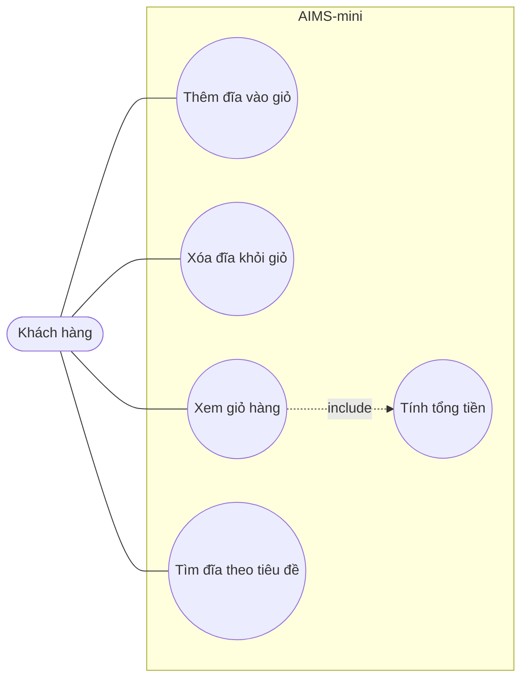

# AIMS-mini – Biểu đồ Use Case

| Use case | Mô tả | Hiện thực |
|---|---|---|
| Thêm đĩa vào giỏ | Giỏ tối đa 20 đĩa | `Cart.add_dvd` |
| Xóa đĩa khỏi giỏ | Báo lỗi nếu đĩa không có trong giỏ | `Cart.remove_dvd` |
| Xem giỏ hàng | In danh sách đĩa và tổng tiền; giỏ trống thì báo "The cart is empty" | `Cart.print_cart` |
| Tìm đĩa theo tiêu đề | Trả về các đĩa có tiêu đề chứa từ khóa | `search_by_title` |
| Tính tổng tiền | Tổng giá các đĩa trong giỏ | `Cart.total_cost` |
